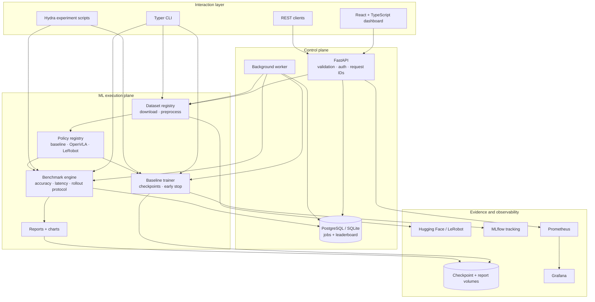

<div align="center">

# VLA-Eval

### An end-to-end engineering platform for training, evaluating and operating Vision-Language-Action policies

[](https://github.com/haarikaalla/VLAEval/actions/workflows/ci.yml)
[](https://github.com/haarikaalla/VLAEval/actions/workflows/security.yml)
[](https://github.com/haarikaalla/VLAEval/actions/workflows/nightly-benchmark.yml)


</div>

VLA-Eval is a production-shaped research platform for **Vision-Language-Action (VLA) robotics evaluation**. It brings dataset discovery, reproducible preprocessing, policy adapters, baseline training, open-loop benchmarking, experiment tracking, persistent jobs, report generation and leaderboard publishing into one coherent system.

The project is designed to answer a larger engineering question than “can a model produce an action?”:

> How can a robotics team run comparable policy experiments, preserve their evidence, expose results through stable interfaces and operate the workflow beyond a single notebook?

VLA-Eval addresses that question with a typed Python core, FastAPI control plane, React dashboard, MLflow tracking, PostgreSQL-backed job state, Docker Compose environment, Kubernetes overlays and multi-layer CI/CD.

> **Scope statement:** the lightweight CNN baseline has a complete, tested train → evaluate → report path. OpenVLA and LeRobot adapters provide a common loading and inference interface, but their architecture-specific training losses are not yet integrated into the generic trainer. The README distinguishes implemented behavior from extension points so that platform maturity is clear and reproducible.

## Contents

- [Why this is an advanced engineering project](#why-this-is-an-advanced-engineering-project)
- [Capability and maturity map](#capability-and-maturity-map)
- [System architecture](#system-architecture)
- [End-to-end workflows](#end-to-end-workflows)
- [Datasets](#datasets)
- [Policies and training support](#policies-and-training-support)
- [Evaluation contract](#evaluation-contract)
- [Quick start](#quick-start)
- [CLI and configuration](#cli-and-configuration)
- [API and dashboard](#api-and-dashboard)
- [Experiment tracking and operations](#experiment-tracking-and-operations)
- [Testing, security and delivery](#testing-security-and-delivery)
- [Known boundaries and roadmap](#known-boundaries-and-roadmap)
- [Repository map](#repository-map)

## Why this is an advanced engineering project

VLA-Eval demonstrates the system design around a machine-learning model, not only the model definition itself.

| Engineering concern | What the repository demonstrates |
| --- | --- |
| Stable abstractions | A shared `VLAPolicy` contract decouples evaluation and serving from specific policy implementations |
| Reproducible data | Curated dataset metadata, Hugging Face revision support, deterministic synthetic fixtures and saved normalization statistics |
| Training lifecycle | PyTorch behavior-cloning loop with AdamW, OneCycleLR, gradient clipping, validation, early stopping and best/final checkpoints |
| Evaluation discipline | Action-error metrics, latency percentiles, throughput, optional rollout success and explicit composite-score semantics |
| Experiment evidence | MLflow parameters and per-epoch metrics plus generated Markdown reports and charts |
| Durable orchestration | Database-backed job states and leaderboard records survive API restarts |
| Multiple interfaces | The same capabilities are exposed through Python modules, Typer CLI, Hydra scripts, REST API and React UI |
| Operational visibility | Structured request logs, request IDs, health/readiness probes, Prometheus and provisioned Grafana dashboards |
| Delivery engineering | Per-service containers, Compose, Kubernetes/Kustomize overlays, GHCR image publishing and manual gated deployment |
| Quality controls | Python and frontend tests, lint, formatting, typing, CodeQL, secret scanning, image scanning and manifest rendering |

The important design choice is separation of concerns: dataset code does not know about HTTP, evaluation does not know about React, and model adapters implement a narrow interface consumed by the benchmark engine.

## Capability and maturity map

This table is the fastest way to understand what is complete today.

| Capability | Status | Evidence / boundary |
| --- | :---: | --- |
| Synthetic offline demonstration | ✅ Complete | Deterministic, network-free pipeline used by tests and nightly smoke benchmarks |
| Baseline CNN training | ✅ Complete | Fully tested training, validation, early stopping and checkpoint round trip |
| Open-loop policy evaluation | ✅ Complete | Action MSE/MAE/max error, per-dimension error and latency statistics |
| Reports and leaderboard | ✅ Complete | Markdown + chart generation; API evaluations persist ranked database entries |
| Public dataset registry | ✅ Complete | Simulated and physical-robot LeRobot datasets with license/action metadata |
| Hugging Face acquisition | ✅ Complete | LeRobot-native loader with Hub snapshot fallback and programmatic revision pinning |
| OpenVLA adapter | 🟡 Adapter | Lazy loading, quantization configuration, LoRA attachment and inference interface; native fine-tuning loop remains future work |
| LeRobot ACT/Diffusion adapters | 🟡 Adapter | Lazy policy loading and inference interface; native action-chunking/diffusion training remains future work |
| Closed-loop evaluation | ✅ Synthetic | Concrete deterministic reach environment exercises observations, actions, termination, success rate and latency; robotics simulators remain adapters |
| Distributed jobs | ✅ Complete | Durable SQL jobs, atomic Postgres claiming and explicit `inline`/`worker` ownership prevent API/worker races |
| JWT browser authentication | ✅ Complete | Dashboard exchanges the API key once, stores a short-lived JWT and uses bearer auth for protected job operations |
| Redis, S3 and rate limits | ⚪ Planned | Configuration placeholders exist, but they are not active runtime dependencies in the current execution path |

Legend: ✅ complete and exercised · 🟡 implemented foundation or adapter with an explicit integration boundary · ⚪ planned contract, not active behavior.

## System architecture



### Architectural responsibilities

| Layer | Responsibility |
| --- | --- |
| Data plane | Locate datasets, download/cache them, standardize observations and preserve action statistics |
| Policy plane | Present different robotics policies through `predict`, `reset`, lifecycle and persistence methods |
| Training plane | Train the supported baseline without coupling it to the API or dashboard |
| Evaluation plane | Produce comparable evidence from predictions, latency and optional rollout success |
| Control plane | Validate requests, persist job state, coordinate execution and publish leaderboard records |
| Experience plane | Let users browse datasets, submit work, monitor jobs and inspect rankings |
| Operations plane | Track experiments, expose telemetry, package services and validate deployment manifests |

See [docs/architecture.md](docs/architecture.md) for module-level details.

## End-to-end workflows

### 1. Dataset preparation

```text
Registry name
  → Hugging Face/LeRobot repository metadata
  → revision-aware download and local cache
  → image/state/action extraction
  → resize + CHW float conversion
  → action statistics
  → VLAEpisodeDataset
```

The repository stores metadata and code, not third-party dataset payloads or model weights.

### 2. Tested baseline training path

```text
VLAEpisodeDataset
  → deterministic train/validation split
  → CNN image encoder + state encoder + action head
  → behavior-cloning MSE objective
  → AdamW + OneCycleLR + gradient clipping
  → early stopping + best/final checkpoints
  → MLflow parameters and epoch metrics
```

### 3. Evaluation and publication

```text
Policy + evaluation dataset
  → per-sample action prediction
  → action error + latency measurements
  → composite score
  → Markdown report + chart
  → database leaderboard entry (API workflow)
```

### 4. API job lifecycle

| State | Meaning |
| --- | --- |
| `PENDING` | Request is validated and stored |
| `RUNNING` | An executor has claimed the job |
| `SUCCEEDED` | Result metadata is persisted and available to the UI |
| `FAILED` | A captured error is stored for diagnosis |
| `CANCELLED` | Reserved lifecycle state for future cancellation support |

## Datasets

VLA-Eval registers public robot-learning datasets distributed through the Hugging Face **LeRobot** collection. The catalog includes simulated benchmarks and physical-robot demonstrations.

| Registry key | Hub repository | Task | Action dim | Source type | License metadata |
| --- | --- | --- | :---: | :---: | :---: |
| `pusht` | `lerobot/pusht` | Push a T-block to a target pose | 2 | Simulation | MIT |
| `aloha_sim_insertion_human` | `lerobot/aloha_sim_insertion_human` | Bimanual peg insertion | 14 | Simulation | MIT |
| `aloha_sim_transfer_cube_human` | `lerobot/aloha_sim_transfer_cube_human` | Bimanual cube transfer | 14 | Simulation | MIT |
| `xarm_lift_medium` | `lerobot/xarm_lift_medium` | xArm lifting | 4 | Simulation | MIT |
| `berkeley_autolab_ur5` | `lerobot/berkeley_autolab_ur5` | UR5 tabletop manipulation | 7 | Physical robot | CC-BY-4.0 |
| `bridge_orig` | `lerobot/bridge_orig` | BridgeData V2 manipulation | 7 | Physical robot | CC-BY-4.0 |
| `synthetic` | Generated in process | Deterministic engineering fixture | 7 default | Synthetic | Not applicable |

Important data rules:

- The synthetic dataset verifies software flow; its random targets do **not** constitute robotics performance evidence.
- Real dataset preprocessing requires the optional LeRobot dependency.
- Large datasets can require hundreds of gigabytes. Limit preprocessing with `--max-episodes` during exploration.
- Hub revisions can be pinned through the programmatic downloader for reproducible acquisition.
- Dataset license metadata is recorded, but users remain responsible for verifying upstream terms before redistribution or commercial use.

## Policies and training support

All policy adapters implement the same prediction contract, but they do not yet share one universal training objective.

| Model key | Architecture | Load / inference | Generic trainer | Intended role |
| --- | --- | :---: | :---: | --- |
| `baseline-cnn` | CNN image encoder + state MLP + action head | ✅ | ✅ | CPU-friendly reference and complete smoke path |
| `openvla` | OpenVLA-7B vision-language-action model | ✅ adapter | Not yet | GPU evaluation and future parameter-efficient fine-tuning integration |
| `lerobot-act` | Action Chunking Transformer | ✅ adapter | Not yet | Chunked-policy integration point |
| `lerobot-diffusion` | Diffusion Policy | ✅ adapter | Not yet | Diffusion-policy integration point |

The repository contains LoRA configuration helpers and an OpenVLA adapter capable of attaching PEFT adapters. Completing OpenVLA training requires an architecture-specific batch processor and loss path; completing ACT/Diffusion training requires their native sequence/chunk or diffusion objectives. The generic `Trainer` deliberately fails with a clear error when a model does not expose the baseline `.net` forward contract, preventing a false “successful” training run.

## Evaluation contract

### Open-loop benchmark

For each recorded observation, the policy predicts an action that is compared with the demonstrator action.

| Metric | Meaning |
| --- | --- |
| Action MSE | Mean squared error across samples and action dimensions |
| Action MAE | Mean absolute action error |
| Maximum error | Largest absolute error observed |
| Per-dimension MSE | Identifies action coordinates with disproportionate error |
| p50/p95/p99 latency | Inference-time distribution |
| Throughput | Approximate single-sample in-process predictions per second |

Open-loop error is deterministic and inexpensive, but it is a proxy. A policy can imitate recorded actions well and still fail after its own actions move the robot away from the demonstration trajectory.

### Closed-loop evaluation

`run_closed_loop_benchmark` accepts any simulator implementing:

```python
reset() -> Observation
step(action) -> (Observation, reward, done, info)
```

It measures episode success and inference latency. `SyntheticReachEnv` is a deterministic, network-free implementation used to validate the complete rollout and reporting path. Select **Closed-loop simulator** in the Evaluation Jobs dashboard to choose episode count, maximum steps and action dimensions. This synthetic task is engineering evidence, not a robotics-performance claim: LIBERO, SimplerEnv, ManiSkill or physical-robot results still require their own validated adapter and safety protocol.

### Composite score

The leaderboard score is intentionally simple and inspectable:

```text
accuracy = 1 / (1 + action_mse)
speed    = min(1, 10 ms / mean_latency_ms)

closed loop: 100 × (0.60 × success + 0.30 × accuracy + 0.10 × speed)
open loop:   100 × (0.90 × accuracy + 0.10 × speed)
```

Scores are comparable only when the **dataset, action representation, preprocessing, sample count and hardware** are comparable. A global leaderboard rank across different tasks or action scales is a convenience view, not a scientific claim.

## Quick start

### Full local stack with Docker Compose

Prerequisites: Docker with Compose and enough disk for the selected datasets/models.

```bash
git clone --depth 1 https://github.com/haarikaalla/VLAEval.git
cd VLAEval
cp .env.example .env
```

Replace the development secrets in `.env`, then start the stack:

```bash
docker compose up -d --build
```

| Interface | URL |
| --- | --- |
| React dashboard | <http://localhost:8080> |
| FastAPI Swagger UI | <http://localhost:8000/api/docs> |
| MLflow | <http://localhost:5000> |
| Prometheus | <http://localhost:9090> |
| Grafana | <http://localhost:3000> |

### Network-free synthetic smoke run

```bash
python3.11 -m venv .venv
source .venv/bin/activate                  # Windows: .venv\Scripts\activate
python -m pip install --upgrade pip
pip install torch --index-url https://download.pytorch.org/whl/cpu
pip install -e ".[dev]"

export MLFLOW_TRACKING_URI=sqlite:///./mlruns.db
vla-eval data list
vla-eval train --dataset synthetic --model baseline-cnn --epochs 1
vla-eval evaluate --dataset synthetic --model baseline-cnn --max-samples 32
```

The evaluation command writes a Markdown report and chart under `reports/generated/`.

### Real dataset workflow

Install the optional LeRobot integration first:

```bash
pip install -e ".[lerobot]"
vla-eval data download pusht
vla-eval data preprocess pusht --max-episodes 100
vla-eval train --dataset pusht --model baseline-cnn --epochs 20
vla-eval evaluate --dataset pusht --model baseline-cnn --max-samples 500
```

Use an `HF_TOKEN` for gated/private repositories. Start with a subset before committing large storage or GPU time.

## CLI and configuration

```bash
vla-eval data list
vla-eval data download pusht
vla-eval data preprocess pusht --max-episodes 100
vla-eval train --dataset synthetic --model baseline-cnn --epochs 2
vla-eval evaluate --dataset synthetic --model baseline-cnn
vla-eval serve
```

Every command supports `--help`.

### Hydra experiments

Hydra composes dataset, model, training and evaluation configuration from [`configs/`](configs):

```bash
python scripts/train.py dataset=synthetic model=baseline training.num_epochs=2
python scripts/train.py -m dataset=synthetic model=baseline training.learning_rate=1e-4,5e-5
python scripts/evaluate.py dataset=synthetic model=baseline evaluation.max_samples=32
```

The OpenVLA/LoRA and LeRobot configuration files are forward-looking integration presets; they should not be presented as completed native training paths until the corresponding trainer adapters are implemented.

Runtime/service configuration is environment-driven through `pydantic-settings`. Experiment hyperparameters are kept separately in Hydra YAML, preventing service settings from being mixed with research configuration. See [.env.example](.env.example) and [docs/training-guide.md](docs/training-guide.md).

## API and dashboard

All application endpoints use `/api/v1`. OpenAPI is available at `/api/docs` and `/api/redoc`.

| Method | Path | Authentication | Purpose |
| --- | --- | --- | --- |
| `GET` | `/healthz`, `/readyz`, `/metrics` | Public | Liveness, dependency readiness and telemetry |
| `GET` | `/api/v1/datasets`, `/models`, `/leaderboard` | Public | Discovery and published results |
| `POST` | `/api/v1/datasets/download` | API key or JWT | Start a dataset download |
| `POST` | `/api/v1/training/jobs` | API key or JWT | Submit baseline training work |
| `GET` | `/api/v1/training/jobs[/{id}]` | API key or JWT | Inspect training job state |
| `POST` | `/api/v1/evaluation/jobs` | API key or JWT | Submit open- or closed-loop evaluation work |
| `GET` | `/api/v1/evaluation/jobs[/{id}]` | API key or JWT | Inspect evaluation job state |
| `GET` | `/api/v1/evaluation/jobs/{id}/report` | API key or JWT | Download the generated Markdown report |
| `POST` | `/api/v1/auth/token` | API key | Issue a short-lived JWT |
| `GET` | `/api/v1/auth/me` | API key or JWT | Inspect the authenticated caller |

Example:

```bash
export API_KEY='replace-with-the-value-from-your-env'

curl -X POST http://localhost:8000/api/v1/evaluation/jobs \
  -H "X-API-Key: ${API_KEY}" \
  -H "Content-Type: application/json" \
  -d '{"model_name":"baseline-cnn","dataset_name":"synthetic","device":"cpu","max_samples":32}'
```

The React dashboard provides four connected views:

1. **Leaderboard** — ranked results, task filtering and a score chart.
2. **Datasets** — registry metadata, source, task type, action dimension and license.
3. **Training Jobs** — validated job submission and live status polling.
4. **Evaluation Jobs** — open/closed-loop submission, status, composite-score results and authenticated report downloads.

Use the dashboard header to sign in. The API key is sent only to the token-exchange endpoint and is not persisted by the browser; the returned short-lived JWT is used for training, evaluation, dataset-download and job-status requests. The token carries an operator role and the API records the submitting identity. Multi-user identity providers and fine-grained per-project permissions remain deployment-specific extensions.

## Experiment tracking and operations

### MLflow

The trainer records:

- run name and experiment;
- model, dataset and split sizes;
- epoch-level training/validation loss;
- epoch duration and training parameters.

Checkpoints and generated reports are written to configured artifact directories/volumes. Uploading those files as MLflow artifacts is a clear next integration step; the current code should not be described as already doing so.

### Observability

- Structured application and HTTP logs
- Caller-supplied or generated `X-Request-ID`
- Prometheus FastAPI instrumentation at `/metrics`
- Liveness and database-backed readiness endpoints
- Grafana datasource and API overview dashboard provisioning
- Container health checks and restart policies

### Persistence

- PostgreSQL stores job and leaderboard records in Compose/Kubernetes.
- SQLite provides a zero-service local-development option.
- Named volumes preserve PostgreSQL, MLflow, dataset, checkpoint and report data in Compose.
- Alembic migrations provide an explicit production schema path.

## Testing, security and delivery

Run the local quality gate:

```bash
make check
cd frontend && npm test && npm run build
```

The Python unit/integration suite covers dataset registration, preprocessing, metrics, ranking, baseline prediction/checkpointing, synthetic closed-loop rollouts, training, JWT authentication, health/readiness and the API train → evaluate → leaderboard path. Frontend tests cover reusable UI behavior, and the production dashboard must pass lint plus a TypeScript build.

GitHub automation validates:

- Python 3.10, 3.11 and 3.12 tests with coverage;
- Ruff, Black and mypy;
- React lint, type checking, production build and Vitest;
- API, worker, frontend and MLflow container builds;
- staging and production Kustomize rendering and image-name consistency;
- CodeQL, gitleaks, Bandit, dependency review and Trivy scans;
- nightly synthetic benchmark report generation;
- GHCR image publication and manual, environment-gated Kubernetes deployment.

Dependency-audit and container-vulnerability findings are currently informational in parts of the workflows (`pip-audit` and Trivy do not block delivery). This is intentional visibility, not a claim of zero vulnerabilities.

## Deployment

| Target | Command / workflow | Purpose |
| --- | --- | --- |
| Local integration | `docker compose up -d --build` | Complete service stack |
| Staging manifests | `kubectl apply -k deploy/k8s/overlays/staging` | Lower replicas and staging configuration |
| Production manifests | `kubectl apply -k deploy/k8s/overlays/production` | Production configuration baseline |
| Image delivery | `.github/workflows/cd.yml` | Build and publish commit-pinned GHCR images |
| Cluster rollout | Manual `Deploy` workflow | Requires cluster/application secrets, environment approval, rollout checks and an in-cluster API smoke test |

Kubernetes files are deployable templates, not evidence of an active public cluster. Operators must supply secrets, storage classes, ingress/DNS/TLS and capacity appropriate for their GPU/CPU workloads.

## Known boundaries and roadmap

An advanced project is credible when its limitations are explicit. The highest-value next steps are:

1. **Architecture-specific trainers:** integrate OpenVLA token/action losses, ACT action-chunking losses and Diffusion Policy objectives.
2. **Episode-safe splitting:** replace the current sample-level random split with episode/task/environment partitions to prevent correlated-frame leakage.
3. **Action normalization in training:** apply saved normalization statistics consistently and record the action representation in benchmark metadata.
4. **Robotics closed-loop adapters:** extend the working synthetic rollout path with LIBERO, SimplerEnv or ManiSkill and report confidence intervals across seeds/tasks.
5. **Fair leaderboard contracts:** partition rankings by dataset revision, preprocessing contract, checkpoint, hardware and evaluation mode.
6. **Broker-backed scheduling:** replace SQL polling with Redis/RQ, Celery or another explicit broker when queue volume needs priorities, retries and autoscaling signals.
7. **Enterprise identity:** connect an OIDC provider and extend the working JWT operator flow with per-project roles and audit events.
8. **Active platform controls:** implement rate limiting and object-storage integration instead of exposing configuration placeholders only.
9. **Artifact lineage:** attach checkpoint/report URIs and dataset revisions to MLflow runs and leaderboard entries.
10. **Stronger release gates:** make dependency and container vulnerability policies blocking at an agreed severity threshold.

Scientific interpretation boundaries:

- Synthetic results validate engineering, not robot capability.
- Open-loop action similarity does not prove closed-loop task success or safety.
- A single composite score hides tradeoffs and must be accompanied by component metrics.
- Latency comparisons require the same hardware, precision, batch size and warm-up protocol.
- Physical-robot deployment requires independent safety controls, workspace constraints, emergency stops and human supervision outside this software.

## Repository map

```text
.
├── src/vla_eval/
│   ├── api/                 # FastAPI, persistence, auth and background jobs
│   ├── cli/                 # Typer command-line interface
│   ├── core/                # settings, logging and domain exceptions
│   ├── data/                # registry, Hub downloads and preprocessing
│   ├── evaluation/          # metrics, benchmarks, reports and ranking
│   ├── models/              # baseline, OpenVLA and LeRobot adapters
│   ├── training/            # baseline trainer, callbacks, LoRA and MLflow helpers
│   └── utils/               # device, I/O and reproducibility helpers
├── frontend/                # React + TypeScript operations dashboard
├── configs/                 # Hydra experiment composition
├── scripts/                 # Hydra training/evaluation entry points
├── tests/                   # Python unit and integration tests
├── migrations/              # Alembic schema versions
├── docker/                  # service-specific Dockerfiles and observability config
├── deploy/k8s/              # Kustomize base, staging and production overlays
├── docs/                    # architecture, API, training and deployment guides
└── .github/workflows/       # CI, security, nightly benchmark, image CD and deploy
```

## A concise reviewer walkthrough

For a five-minute demonstration:

1. Start with the [capability map](#capability-and-maturity-map) to establish honest scope.
2. Explain the control-plane/execution-plane separation in the [architecture](#system-architecture).
3. Run the synthetic baseline path to prove reproducibility without external data or a GPU.
4. Show the generated report, persisted job state, leaderboard and MLflow metrics.
5. Explain why open-loop MSE is useful but insufficient for robotics success.
6. Finish with the roadmap from baseline infrastructure to real closed-loop VLA evaluation.

## Documentation

| Document | Focus |
| --- | --- |
| [Architecture](docs/architecture.md) | Module responsibilities and data flow |
| [Training guide](docs/training-guide.md) | Datasets, configs, LoRA concepts and MLflow |
| [API reference](docs/api-reference.md) | Endpoints and request/response contracts |
| [Deployment guide](docs/deployment.md) | Compose and Kubernetes operations |
| [Contributing](CONTRIBUTING.md) | Development workflow and standards |
| [Security](SECURITY.md) | Disclosure policy and security design |

## License

Licensed under the [Apache License 2.0](LICENSE).

---

<div align="center">

Built around PyTorch, Hugging Face/LeRobot, FastAPI, React, MLflow and Kubernetes—with explicit boundaries between tested capability and future integration.

</div>
